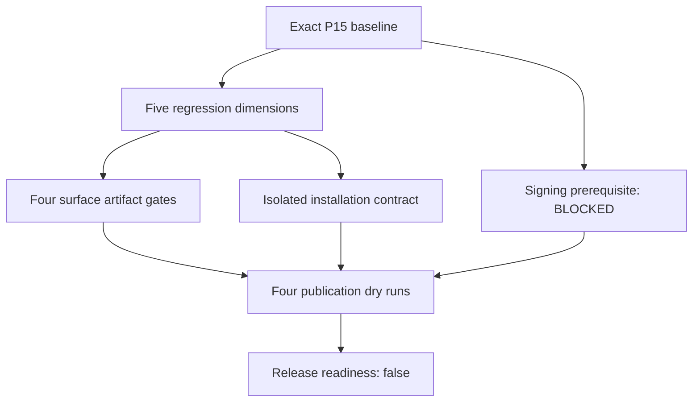

# P16.10 CI Release Pipeline & Publication Dry Run — Review Evidence

## Baseline and incoming inventory

Branch: `p16-1-release-baseline`.
HEAD / P15 freeze: `c9c5ca186c9d942ce336ac1ebfe1287b16953200`.
Tag: `afp-p15.14-freeze`.
Annotated tag object: `d7761c04e4422bfb91d9582275a60912874678f4`.
Peeled target equals HEAD. Initial tracked/staged diffs empty, no generated/ignored
residue, exactly 27 incoming P16 candidates. Accepted P16.1 DLL/EXE format
correction and wasm rejection remain incoming state, not new defects.

Incoming SHA-256 census:
```text
D8849A290CF65A0FAB56416CFE0D6DD4588CAD28425E2B218BB604F918EEF869  apexforge/p16_1_release_architecture_contract_test.py
72F967A103FA768DA4FC6202A491032B700C0E8A7AF392CFA323C9834BAC0F3B  apexforge/p16_2_release_versioning_compatibility_test.py
FE69072FB7749510A6FC2FA79E5D96622D35C0434840A402A6B9839ADF555FFC  apexforge/p16_3_reproducible_release_build_test.py
1161A6BE8AB4DCA1434E6DD5C7D76549F5730DF0C2A3A5CC3FACCE04EA78332B  apexforge/p16_4_release_manifest_provenance_test.py
8F3D05AF732B5779BB5D4BB4153F996043D438E2074091B33F7BA53064BD4621  apexforge/p16_5_python_distribution_packaging_test.py
F12B0E26ED0589CBD11DF8F6729A8D10801EF3900E438000B422BAE4012F7DDE  apexforge/p16_6_vscode_distribution_packaging_test.py
3D3CEA0DA2FD2F1E8F779EB40628B6E7E4DA0E3B6854057360B12B4AAC3DB616  apexforge/p16_7_visualstudio_distribution_packaging_test.py
01639541D42E0F9814897F73EEABE54C6E78F064F593613AFEAD000D238D1C5E  apexforge/p16_8_native_distribution_packaging_test.py
FB928F16E828F5013074EFB697262C54A76E7E6E88D9708E3CBA14CD99411E72  apexforge/p16_9_install_upgrade_rollback_test.py
F2070A9831DD461321342CBCC8AC79CDB41BE6F59E41375471FDBD4A3DE88D3B  apexforge/tooling/native_distribution.py
219242747171DE29D7A24F81BA4C018A8F70CFFADEE0F0496959914A55D2219F  apexforge/tooling/python_distribution.py
9662672BA7CFE5FDD0C1DDD71B02B6C8804D8C2EA58FE4DF8E6D2E3F0B7679AC  apexforge/tooling/release_architecture.py
1D6A99FBF877A0761A99948CEC295E149AA3A7ABB4CB8E39605A5CFB1DF43A6E  apexforge/tooling/release_build.py
8024EBC81C3910B188D741BBE6EBBF23F423782628546EF2C700FF391FC19219  apexforge/tooling/release_installation.py
75C97D8132DA40FD4D25D2D1BC49873D297156BF24B1ED802E58B95505AE9A54  apexforge/tooling/release_manifest.py
0B7F1BF949A1803637F826F4F31FC7F68D384CFF6C2CD3EEE6C9D4024FED52CB  apexforge/tooling/release_versioning.py
D92139A8BD491347762A488AEFBDF3C50E945E8F4923A5A339C7D6084F4E474F  apexforge/tooling/visualstudio_distribution.py
60040C7E90D99BC14771D9CC93DA7F8D518BB25157A6E17F9AFB3ADDCBB6EBB8  apexforge/tooling/vscode_distribution.py
1CCFB01BA43A4A178DEF2BA99FE10176F07FB9021C1D91F45F60B90600BA16A1  docs/p16/P16_1_RELEASE_ARCHITECTURE.md
F00CB44333888CF58575C5715441B53D9488CDF802F839B26B04C09D29EF647D  docs/p16/P16_2_VERSION_COMPATIBILITY_UPGRADE_POLICY.md
BE85A9B19D370E4DDABF5A3125838DE892855DC3FC5969A8AB41B982E6877B07  docs/p16/P16_3_REPRODUCIBLE_RELEASE_BUILD.md
97A124306C8EB86AEF07BA8BFBB95804FDA04D96B0771F78E77DAE7838AD0C39  docs/p16/P16_4_RELEASE_MANIFEST_PROVENANCE.md
478EE3227FEA029B7C1F9193F66D83D7D93D1A68E214AC0B9B29C18299B22BF6  docs/p16/P16_5_PYTHON_DISTRIBUTION_PACKAGING.md
0FB837164A660844374A7C8534FD4AC88C36DC79CCAC7988736351B56D064F4F  docs/p16/P16_6_VSCODE_DISTRIBUTION_PACKAGING.md
0F83C51FB2C9B8E93B4D39CBDA03ACC82DCF12B6CD08DF031960A7D324DD4E90  docs/p16/P16_7_VISUAL_STUDIO_DISTRIBUTION_PACKAGING.md
9187091909FF50B12D3A6F4321CBBC2E5A13D433D4CFC716AC2B609E16C282AF  docs/p16/P16_8_NATIVE_WIN_X64_DISTRIBUTION_PACKAGING.md
47D54B944421C67339DA74DACFC51EE451C84F858BDE6E35236EC0BE61835657  docs/p16/P16_9_INSTALL_UPGRADE_ROLLBACK.md
```

Only release_pipeline.py, its focused test and this report are added. P16.11
signing, P16.12 acceptance and P16.13 closure/freeze remain deferred.

## CI/release ownership census

| Repository evidence | Classification | Use / boundary |
| --- | --- | --- |
| No .github workflows, Azure/GitLab pipeline, Jenkinsfile, Travis or CircleCI configuration found in inspected tracked/working files | NO_CANONICAL_CI_PROVIDER | Provider-neutral fallback; hosting does not select a provider |
| run_apexforge_regressions.ps1 | FROZEN_REGRESSION_OWNER / REFERENCE_ONLY | Existing wrapper accepts all/p7/p8/p9/p10 and delegates to regression_harness.py; not a release CI provider |
| regression_harness.py | FROZEN_REGRESSION_OWNER / REFERENCE_ONLY | Existing command execution stays outside production P16.10 |
| P11 PowerShell acceptance / build and package-owner scripts | REFERENCE_ONLY | Local acceptance/build conventions; no release-provider authority |
| P10–P15 closure/freeze evidence and P15.14 report | REFERENCE_ONLY | Reviewed local commit/tag/push mechanics are not CI triggers |
| P16.1 release matrix and exact baseline | REUSE | Release/source/target/descriptor identity |
| P16.2 upgrade/compatibility assessment | REUSE | Consume exact owner result, no policy redefinition |
| P16.3 artifacts and P16.4 manifest/checksum/provenance | REUSE | Exact structural references and typed adapters |
| P16.5–P16.8 packaging evidence reports | REFERENCE_ONLY / REUSE | Explicit historical owner-build and limitation evidence |
| P16.9 immutable receipt and reviewed isolated contract | REUSE / REFERENCE_ONLY | Evidence consumption only; never apply/install |
| New pipeline DAG/evidence evaluation | RELEASE_PIPELINE_EXTENSION_POINT | Passive provider-neutral contract |
| Logical publication declarations and dry-run records | PUBLICATION_EXTENSION_POINT | No provider API, endpoint/client, upload or credential value |
| Signing, acceptance, freeze | DEFER_TO_P16_11 / DEFER_TO_P16_12 / DEFER_TO_P16_13 | Required future-owner prerequisites; no implementation |

No CI-provider file is created. No remote workflow, tag or push trigger is invoked
or simulated as a live event.

## Identity, bounded steps and graph

ReleasePipelineIdentity binds the exact P16.1 architecture fingerprint, explicit
ReleaseIdentity, exact P15 baseline, schema apexforge.release-pipeline/v1,
provider PROVIDER_NEUTRAL, canonical step graph and required evidence classes.
Changing the graph, release, descriptors or evidence requirements re-identifies it.
The exact schema and provider strings reject caller-defined equality callbacks.

PipelineStep is immutable, with a bounded phase vocabulary:
BASELINE_VALIDATION, REGRESSION_VALIDATION, ARTIFACT_EVIDENCE,
INSTALLATION_CONTRACT, SIGNING_GATE, PUBLICATION_DRY_RUN,
RELEASE_READINESS_SUMMARY. No commands, arbitrary predicates, callbacks, provider
job objects or general-purpose CI language exist.

Kahn-style iterative canonical ordering sorts available IDs and canonicalizes
predecessors/requirements. Duplicate IDs, unknown predecessors and cycles reject.
The baseline must be the first unique root. Mandatory gates/requirements cannot
be removed. Each publication node must retain its exact surface's artifact gate,
regression, installation and signing ancestors. Summary must retain all
publication ancestors. Another surface's successful artifact gate cannot replace
the native or Python gate.

The representative matrix has five descriptors across four surfaces: wheel,
sdist, VS Code VSIX, Visual Studio VSIX, native EXE. Its realistic graph has
13 nodes, not thousands of artificial jobs:


The demonstration ReleaseIdentity install-review / 1.0.0 / DEVELOPMENT is a
declared test/review context, not selection of a production release version.
Surface versions remain Python 10.1.3, VS Code/Visual Studio 0.1.0 and native
profile-v1. Exact native profile remains
apexforge.native.win-x64.i64-literal-state-set/v1.

## Evidence, statuses and owner adapters

GateEvidence carries exact release, bounded kind/subject/status, canonical
references and a bounded structured reason vocabulary. Reasons cannot be free
log text or secret values. PASS requires reference evidence. Baseline PASS
requires the exact P15 baseline reference. Conflicting or duplicate gate keys,
unexpected subjects and cross-release substitution reject.

RegressionEvidence is mandatory for regressions: discovered = passed + skipped +
failed, bounded integer counts, suite identity, exact release and evidence
reference. Count-free generic regression declarations cannot bypass it.
Any failed count yields FAIL; missing totals yield INCOMPLETE; a nonzero skip
count yields SKIPPED, not PASS. Suite dimensions are P16, P15, P14, NATIVE and
AUTHORITY. Authority's count of one denotes one successful smoke invocation,
not an invented count of its individual assertions.

Typed adapters reuse existing owners:
- artifact_gate validates the exact descriptor/build-artifact slot and records
  both fingerprints. Positive artifact evidence must retain the current exact
  descriptor and a P16.3 build-artifact reference.
- manifest_gate consumes P16.4 status and references its exact scoped architecture
  and manifest. Positive manifest evidence must match the exact descriptor matrix
  for that surface; a different artifact cohort cannot substitute.
- compatibility_gate consumes P16.2 DIRECT/INCOMPLETE/UNSUPPORTED/MIGRATION_REQUIRED
  as PASS/INCOMPLETE/FAIL/DEFERRED. Scope and owner-assessment references remain exact.
- installation_gate consumes an immutable P16.9 receipt and records
  ISOLATED_CONTRACT_ONLY. It does not invoke apply or claim real installation.

References and declarations are not authentication. The pipeline does not prove
that an external report is truthful merely from its supplied fingerprint.
Historical owner-build records are distinct from exact current-release artifact
and manifest readiness. The demo does not fabricate a unified release bundle from
earlier target-specific scoped integration passes.

Evaluation preserves observations and blocker reasons before computing gate
status. Failed or non-PASS predecessors block dependents. Signing is BLOCKED by
CRYPTO_PROVIDER_UNAVAILABLE/P16.11; acceptance is DEFERRED to P16.12. An explicit
FAIL is retained, not downgraded to BLOCKED/DEFERRED. UNAVAILABLE descriptors cannot
become ready through a supplied PASS. Missing evidence fails closed; stable channel
and retry without new evidence cannot bypass gates.

Limits: 64 steps, 512 evidence requirements/records, five regression dimensions,
16 structured reason codes per record, existing bounded reference collections and
P16.1 matrix models. The test scenario uses meaningful target/gate combinations
and independent equivalent construction, without a benchmark or meaningless scale.

## Target-by-target facts and limitations

| Surface | Preserved accepted owner evidence | Unresolved prerequisite |
| --- | --- | --- |
| Python | Real local sdist and normalized/content reproducibility PASS | Wheel unavailable; raw sdist timestamp variance retained DEFERRED |
| VS Code | VSIX model/archive/source continuity PASS; exact frozen Git blob projection where CRLF differs | Real offline VSCE artifact unverified; fixture/source continuity does not prove production package |
| Visual Studio | Real cache-only VSIX, build-to-assembly continuity, genuine P16.3/P16.4 adaptation PASS | Independent raw/member/assembly reproducibility DEFERRED for PE/debug/generated/archive metadata |
| Native win-x64 | Real EXE, AMD64, exact build continuity, measured byte reproducibility and P16.3/P16.4 adaptation PASS | Only the frozen bounded profile; not whole-language support or a unified current-release manifest |
| Installation | Isolated install/upgrade/rollback contract PASS | Real symlink test skipped by host; per-file replace plus compensation, not global atomic swap |
| Signing | Requirement declared | P16.11 not implemented; CRYPTO_PROVIDER_UNAVAILABLE |
| Final acceptance/freeze | Future-owner references only | P16.12/P16.13 remain unperformed |

The current review demo records OWNER_BUILD separately from ARTIFACT. Historical
positive builds stay PASS as owner evidence. Exact current release artifact/
manifest evidence remains INCOMPLETE until supplied as that exact bundle; the
historical refs do not silently stand in for it. Content/raw/source facts remain
individually visible even when the dependent surface gate is BLOCKED.

The P16.9 skip is represented both in regression counts and an INSTALLATION_HOST
observation. No actual installation, migration, rollback, package build or
environment repair is executed by P16.10.

## Publication declarations and dry-run results

Bounded logical targets:
- PYTHON_INDEX / PYTHON_PUBLISH_TOKEN
- VSCODE_MARKETPLACE / VSCODE_PUBLISH_TOKEN
- VISUAL_STUDIO_MARKETPLACE / VISUAL_STUDIO_PUBLISH_TOKEN
- NATIVE_RELEASE_ASSET / NATIVE_ASSET_PUBLISH_TOKEN

These are symbolic credential classes under project-owner release direction,
not actual credentials or proof of a configured publishing provider. Native asset
declaration does not select GitHub Releases. No token argument, credential API,
environment-secret lookup, .pypirc/keyring access or signing key is provided.

PublicationDryRunRecord is immutable and binds exact release, target, pipeline
result, descriptor/artifact/manifest references, prerequisite observations,
blockers and symbolic requirements. It always records publication_performed=False,
network_publication_calls=0, approved/trusted/authority=False. No API is called,
even for a hypothetical eligible record. Current signing/acceptance prerequisites
cannot be supplied as fabricated PASS.

Actual evaluator run, incoming review evidence snapshot:
```text
Pipeline fingerprint:
F6F692D7CF2A2208DF5DFBF38F89E9CE05A67349BE5A9D751C0E4F6FBF9ABE21
Incoming-snapshot result:
385B886035BF83456975E7E2F25C088065460015BF64B0BDE6C650F14E520A3D

baseline=PASS
regressions=SKIPPED
signing=BLOCKED
artifacts-python=BLOCKED
artifacts-vscode=BLOCKED
artifacts-visual-studio=BLOCKED
artifacts-native-win-x64=BLOCKED
installation=BLOCKED
publication-python=BLOCKED
publication-vscode=BLOCKED
publication-visual-studio=BLOCKED
publication-native-win-x64=BLOCKED
readiness=BLOCKED
release_ready=False
publication_performed=False
```

The incoming demo uses the accepted 309 PASS + one SKIP / 310 P16 snapshot.
After actual final regressions, re-evaluation with 343 PASS + one SKIP / 344,
using a deterministic caller-supplied count-review reference, changed result
identity to
962C402AEA458BA01B680B964B8139F4228B312838FBF786B507995EACA76E06.
Pipeline identity stayed unchanged. All four publication targets stayed BLOCKED,
would_publish_if_authorized=False and publication_performed=False.
Frozen regression evidence remains P15 428, P14 330, native 7 and authority smoke
PASS. Updated counts do not resolve signing, packaging, reproducibility or
host-coverage blockers.

## Security, determinism and milestone boundaries

CI_PIPELINE != RELEASE_AUTHORITY
CI_PASS != RELEASE_APPROVAL
DRY_RUN != PUBLICATION
PUBLICATION_PLAN != PUBLISHED_RELEASE
RELEASE_ARTIFACT_PRESENT != PUBLICATION_ELIGIBLE
CHECKSUM_PRESENT != SIGNED
CI_ENVIRONMENT != TRUSTED_ENVIRONMENT
SECRET_REQUIREMENT != SECRET_VALUE
RELEASE_CHANNEL != TRUST_LEVEL
PIPELINE_SUCCESS != P16_12_ACCEPTANCE
PIPELINE_SUCCESS != P16_13_FREEZE
CANONICAL_AIR
CRYPTO_PROVIDER_UNAVAILABLE

Production code has no network, filesystem discovery, subprocess/shell, Git,
credential, upload, marketplace, timestamp/random/runner-ID, eval/exec or dynamic
callback APIs. It evaluates supplied models only. Static AST audits and evaluation
with filesystem access trapped demonstrate the boundary. Importing P16.9's passive
receipt type does not invoke its isolated executor.

Equivalent independently constructed/permuted models produce identical identity,
graph, statuses, blocker ordering, matrix and records. Input references,
descriptors, manifest/policy fingerprints and regression counts participate in
result identity. No runner hostname, path, job ID, wall clock or environment is
implicitly consulted. The externally run review harness remains separate.

No CI provider configuration, remote job, branch/tag trigger, publication,
installation, signing, acceptance or freeze is performed. P16.10 readiness for
review means correct blocker propagation, not a publishable release.

## Validation and Patch Matrix

Focused P16.10: 34/34 PASS.
Predecessor focused: P16.9 39 PASS + one host-limited SKIP; P16.8 36, P16.7 38,
P16.6 33, P16.5 35, P16.4 41, P16.3 31, P16.2 31, P16.1 25 all PASS.
Final P16 aggregate: 344 discovered, 343 PASS + one SKIP, no failures.
P15: 428/428 PASS. P14: 330/330 PASS. Frozen native profile: 7/7 PASS.
Authority consolidation: wrong principal/capability/resource denial PASS;
authorized RuntimeEngine execution PASS; transactional denied execution PASS.
Only that unchanged frozen smoke exercises RuntimeEngine.

FAILURE -> CLASSIFICATION -> OWNING SECTION -> FROZEN DEPENDENCIES -> PATCH SURFACE
-> LOCAL CONTRACT -> SECTION REGRESSION -> DEPENDENCY REGRESSION ->
CROSS-SECTION REGRESSION -> AGGREGATE REGRESSION -> PRESERVATION AUDIT -> PATCH_MATRIX.

| Finding / review gap | Classification | P16.10-only correction |
| --- | --- | --- |
| Reference-order assumption in initial adapter test | RELEASE_PIPELINE_EVIDENCE_BINDING_GAP | Locate exact artifact fingerprint by owner schema; preserve exact assertion and canonical ordering |
| Removing a prerequisite or using another surface's artifact node could weaken custom graphs | RELEASE_PIPELINE_DAG_GAP / PUBLICATION_REQUIREMENT_GAP | Mandatory requirements and exact required ancestors; cross-surface substitution test |
| Generic PASS could omit regression counts | RELEASE_PIPELINE_STATUS_GAP | Require typed RegressionEvidence; skip/count conservation tests |
| Historical build pass could be confused with current bundle | RELEASE_PIPELINE_TARGET_READINESS_GAP | Separate OWNER_BUILD and exact ARTIFACT/MANIFEST evidence |
| Positive artifact/manifest/compatibility references needed exact owner/cohort binding | RELEASE_PIPELINE_EVIDENCE_BINDING_GAP | Descriptor/build, scoped-matrix/manifest and owner-assessment checks |
| Forced unavailable future gate could downgrade explicit FAIL | RELEASE_PIPELINE_STATUS_GAP | Preserve FAIL while retaining unavailability/deferral reasons; focused propagation check |

No frozen/P16.1–P16.9 file changed. No failure was repaired by making missing
artifacts, skips, signing or deferred reproducibility pass. Earlier host/environment
limitations are carried without changes. The only actual focused test failure
was the canonical-reference position assumption; subsequent review gaps were
closed inside the new owner before final regression.

## Preservation and exact Git state

Final audit: all 27 incoming SHA-256 hashes match byte-for-byte, with exactly
30 intended untracked P16 candidates. Branch remains p16-1-release-baseline;
HEAD and P15 branch remain c9c5ca186c9d942ce336ac1ebfe1287b16953200. P15 tag
object remains d7761c04e4422bfb91d9582275a60912874678f4 and peels to the same
freeze commit. Tracked/staged diffs are empty; no ignored/generated CI, build,
publication, installation or cache residue exists in the repository. No P15 or
earlier path, nor any P16.1–P16.9 file, changed. No credentials were accessed.
No staging, commit, tag, push, provider config creation, remote CI, publication,
signing, final acceptance, freeze, or P16.11 work occurred.

## Evidence-supported markers

```text
P16_BASELINE=P15_14_FREEZE
P15_REOPENED=False
P16_10_INCOMING_CANDIDATES=27
P16_10_REDEFINES_CORE_SEMANTICS=False
P16_10_CI_PROVIDER_INFERRED_FROM_HOSTING=False
P16_10_CANONICAL_CI_PROVIDER_FOUND=False
P16_10_GENERAL_CI_LANGUAGE_IMPLEMENTED=False
P16_10_INSTALLATION_EXECUTION_PERFORMED=False
P16_10_SIGNING_IMPLEMENTED=False
P16_10_SIGNING_GATE_FABRICATED_PASS=False
P16_10_SECRET_VALUES_LOADED=False
P16_10_CREDENTIAL_ACQUISITION=False
P16_10_PUBLICATION_PERFORMED=False
P16_10_DRY_RUN_RELEASE_READY=False
P16_10_FINAL_RELEASE_APPROVAL_GRANTED=False
P16_10_RELEASE_TAG_CREATED=False
P16_10_PUSH_PERFORMED=False
P16_10_REMOTE_CI_TRIGGERED=False
P16_10_PRODUCTION_PIPELINE_RUNS_SHELL=False
P16_10_ARBITRARY_COMMAND_EXECUTION=False
P16_10_WALL_CLOCK_CANONICAL=False
P16_10_RELEASE_CHANNEL_BYPASSES_GATES=False
P16_10_DRY_RUN_GRANTS_TRUST=False
P16_10_PIPELINE_GRANTS_AUTHORITY=False
P16_10_REDEFINES_RELEASE_ARCHITECTURE=False
P16_10_REDEFINES_COMPATIBILITY_POLICY=False
P16_10_REDEFINES_GENERIC_BUILD=False
P16_10_REDEFINES_RELEASE_MANIFEST=False
P16_10_REDEFINES_PYTHON_DISTRIBUTION=False
P16_10_REDEFINES_VSCODE_DISTRIBUTION=False
P16_10_REDEFINES_VISUAL_STUDIO_DISTRIBUTION=False
P16_10_REDEFINES_NATIVE_DISTRIBUTION=False
P16_10_REDEFINES_INSTALLATION_POLICY=False
P16_10_NETWORK_ACCESS=False
P16_10_UNBOUNDED_FILESYSTEM_DISCOVERY=False
P16_10_ARTIFACT_SIGNING_IMPLEMENTED=False
P16_10_CRYPTO_TRUST_FABRICATED=False
P16_10_PYTHON_PUBLICATION_PERFORMED=False
P16_10_VSCODE_MARKETPLACE_PUBLICATION_PERFORMED=False
P16_10_VISUAL_STUDIO_MARKETPLACE_PUBLICATION_PERFORMED=False
P16_10_NATIVE_ASSET_PUBLICATION_PERFORMED=False
P16_10_GITHUB_RELEASE_CREATED=False
P16_10_GIT_MUTATION_PERFORMED=False
P16_10_PROVIDER_NEUTRAL_PIPELINE=True
P16_10_PIPELINE_EXACT_RELEASE_BOUND=True
P16_10_PIPELINE_DAG_DETERMINISTIC=True
P16_10_LIMITATIONS_RETAIN_STATUS=True
P16_10_FAILURE_PROPAGATION_FAILS_CLOSED=True
P16_10_EXACT_P15_FREEZE_BOUND=True
P16_10_SKIPPED_TESTS_NOT_REPORTED_AS_PASS=True
P16_10_TARGET_READINESS_PER_SURFACE=True
P16_10_PYTHON_WHEEL_LIMITATION_PROPAGATED=True
P16_10_VSCODE_BUILD_LIMITATION_PROPAGATED=True
P16_10_VISUAL_STUDIO_REPRODUCIBILITY_LIMITATION_PROPAGATED=True
P16_10_NATIVE_PROFILE_SCOPE_PRESERVED=True
P16_10_P16_9_HOST_LIMITATION_PROPAGATED=True
P16_10_PUBLICATION_TARGETS_BOUNDED=True
P16_10_PUBLICATION_DRY_RUN_PERFORMED=True
P16_10_CI_HOST_STATE_NOT_CANONICAL_IDENTITY=True
P16_10_RETRY_WITHOUT_NEW_EVIDENCE_STABLE=True
P16_10_PIPELINE_RESULT_EXACT_EVIDENCE_BOUND=True
P16_10_UNKNOWN_REQUIREMENT_FAILS_CLOSED=True
P16_10_CONFLICTING_EVIDENCE_FAILS_CLOSED=True
P16_10_PIPELINE_EVIDENCE_DETERMINISTIC=True
P16_10_NETWORK_PUBLICATION_CALLS=0
P16_10_STATIC_SECURITY_AUDIT=PASS
CRYPTO_PROVIDER_UNAVAILABLE
P16_RELEASE_PIPELINE_MODEL=PASS
P16_RELEASE_PIPELINE_DAG=PASS
P16_RELEASE_PIPELINE_EVIDENCE_BINDING=PASS
P16_RELEASE_PIPELINE_FAILURE_PROPAGATION=PASS
P16_RELEASE_PIPELINE_STATUS_MODEL=PASS
P16_RELEASE_PIPELINE_TARGET_READINESS=PASS
P16_RELEASE_PIPELINE_LIMITATION_PROPAGATION=PASS
P16_PUBLICATION_TARGET_MODEL=PASS
P16_PUBLICATION_REQUIREMENTS=PASS
P16_PUBLICATION_DRY_RUN=PASS
P16_PUBLICATION_SECRET_BOUNDARY=PASS
P16_PUBLICATION_SIGNING_GATE=PASS
P16_PUBLICATION_READINESS=PASS
P16_RELEASE_PIPELINE_DETERMINISM=PASS
P16_RELEASE_PIPELINE_SECURITY_BOUNDARY=PASS
P16_9_REGRESSION=PASS_WITH_HOST_LIMITED_SKIP
P16_8_REGRESSION=PASS
P16_7_REGRESSION=PASS
P16_6_REGRESSION=PASS
P16_5_REGRESSION=PASS
P16_4_REGRESSION=PASS
P16_3_REGRESSION=PASS
P16_2_REGRESSION=PASS
P16_1_REGRESSION=PASS
P16_AGGREGATE_REGRESSION=PASS_WITH_HOST_LIMITED_SKIP
P15_AGGREGATE_REGRESSION=PASS
P14_AGGREGATE_REGRESSION=PASS
P12_NATIVE_PROFILE_REGRESSION=PASS
P16_AUTHORITY_COEXISTENCE=PASS
P15_FROZEN_PREDECESSOR_PRESERVED=True
PATCH_MATRIX=PASS
P16_10_READY_FOR_REVIEW=True
```

PASS_WITH_HOST_LIMITED_SKIP is intentionally different from an all-tests PASS.
P16_PUBLICATION_READINESS=PASS means the model correctly says release-ready=False.
